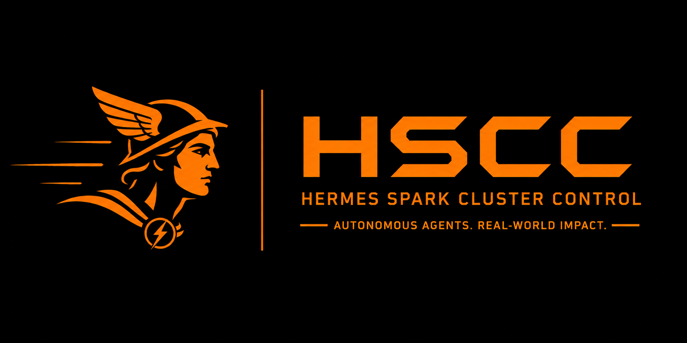

<p align="center">
  
</p>

# HSCC — Hermes Spark Cluster Control

**Turn a DGX Spark GPU cluster into a self-running team of specialized AI agents.**

Say *"build X"* in chat and a fleet of role-specialized agents brainstorms, decomposes, codes, reviews, and lands it — across multiple GPU nodes, hands-off.

[](CHANGELOG.md)
[](LICENSE)
[](requirements.txt)
[](scripts/README.md)

HSCC runs on a cluster of DGX Spark (GB10 / Grace-Blackwell) nodes serving LLMs via vLLM, orchestrated by [Hermes](https://github.com/NousResearch/hermes-agent) agents. It is a pure-Python plugin set with three pinned dependencies (PyYAML, rich, psutil — see `requirements.txt`). You develop in a work repo (`~/dev/hscc`); bootstrap copies the plugins into the Hermes runtime (`~/.hermes/plugins/`), with runtime state in `~/.hscc/`.

The design is **native-Hermes-first**: agent work runs on Hermes' built-in kanban dispatcher and git worktrees. HSCC does not build a dispatcher — it *hooks into* the one Hermes already ships, adding the thin physical layer (cluster control, monitoring, model lifecycle), a role framework for specialized workers, and a review gate on the dispatch path. Why this shape (what stock Hermes lacks and HSCC adds): [docs/WHY.md](docs/WHY.md).

## In plain words (ELI5)

You have a few powerful computers and a team of AI helpers. **HSCC is the manager that runs them for you.** You say what you want built; it splits the work across the computers, hands each piece to the right specialist — one plans, one writes the code, one checks it — and keeps the whole thing running: it restarts anything that crashes, and only pings you when it's genuinely stuck. One command gives you a whole working team, instead of babysitting a single chatbot.

## The stack at a glance

```
DGX Spark nodes (GB10) ── vLLM units ── sparkrun ── worker proxy :4000
     ▲  self-heal (lease+breaker+guard), monitor --live      │
     │                                                       ▼
hscc daemon (launchd) ── Hermes kanban dispatcher ── role workers (worktrees)
     │                                                       ▲
hscc api :8787/8788 (bearer token, tailnet) ── iOS app (QR pair)
```

## Requirements

- A configured [sparkrun](https://sparkrun.dev/) DGX Spark cluster (one or more GB10 nodes)
- [Hermes](https://github.com/NousResearch/hermes-agent) installed (`~/.hermes/hermes-agent`)
- A control host for the daemon — macOS (launchd) or Linux (systemd --user); Python 3
- Python deps: three pinned packages (PyYAML, rich, psutil), installed by bootstrap
- tmux — REQUIRED for the iOS chat path: the app delivers chat by typing into the project's REPL pane; a REPL outside tmux is invisible to it. Delivery matrix: [hscc-api/README.md](hscc-api/README.md)

## Quick start

```
git clone https://github.com/pom11/hscc ~/dev/hscc
~/dev/hscc/hscc-bootstrap/bootstrap.sh --yes
```

Bootstrap detects your cluster from `sparkrun cluster list`, then installs skills, role profiles, `~/.hscc` state, and the monitoring daemon. It does **not** start vLLM models. Drop `--yes` for the two-question interview; after a `git pull` re-run it to pick up changes (it backs up the previous runtime copy; `--no-backup` skips). Then, in order:

```
hscc status                                 # daemon health + all streams at a glance
hscc template list                          # declared fleet layouts for 1–8 nodes (22 today)
hscc template preview 4node-coding          # dry-run against the live cluster
hscc template apply 4node-coding --confirm  # bring up the serving layer
hscc project standup                        # fleet digest: NEEDS YOU / FAILING / STALE / RUNNING
hscc api start --tailscale                  # HTTP API for external apps (prints pairing QR)
```

Then open the iOS app and scan the QR (`hscc api status` reprints it) — [ios-app/README.md](ios-app/README.md).

## Common tasks

| I want to … | Run |
|---|---|
| see the daily fleet digest | `hscc project standup` |
| check health at a glance | `hscc status` · full smoke test: `hscc verify` |
| watch per-node / per-model live load | `hscc cluster monitor --live` |
| see throughput + queue depth, get scaling advice | `hscc throughput` · `hscc autoscale` |
| review + merge a finished card | `hscc project review <card>` |
| see why a card is stuck / un-stick it | `hscc kanban blocked [--recover <id>]` |
| preview what would be escalated | `hscc escalate` (dry-run) |
| shut idle GPUs down | `hscc autodown enable` — OFF by default, see below |
| run / stop the external API | `hscc api start [--tailscale]` · `hscc api stop` |
| the full command surface | `hscc --help` · `hscc help advanced` · `hscc project --help` |

## Cluster templates

Instead of provisioning by hand, apply a template that declares intent (which recipes, how many workers) and resolves against the live cluster at apply — auto-assigning nodes + ports and refusing layouts that don't fit (checked against `sparkrun show` VRAM). The library ships for 1–8 nodes — 22 templates as of 2026-10-19 (`hscc template list`) — and is topology-free by default (no IPs, no ports); a template may state placement/routing explicitly, but **omission means do-not-touch**: apply never silently re-routes something tuned by hand. `hscc template validate <name> --structural-only` runs offline (CI-friendly).

Deep reference: [hscc-cluster/templates/README.md](hscc-cluster/templates/README.md) · explicit-placement schema: [docs/DESIGN-template-explicit-placement.md](docs/DESIGN-template-explicit-placement.md)

## Idle autodown

After the cluster has been quiet for X minutes the daemon can tear the whole **GPU serving layer** down to save power and bring it back up automatically on the next API/kanban activity or `hscc autodown wake`:

```
hscc autodown status [--json]              # read-only: armed? state? idle window?
hscc autodown enable [--idle-minutes N]    # arm it — OFF by default until you do
hscc autodown wake · cancel · disable      # wake now / abort teardown / disarm
```

It never tears down while kanban work is running/ready/in-review, while an agent is busy, or if any signal can't be verified. Cron-conflict classification, messages-while-down behaviour, and the full never-do list: [docs/design/idle-autodown.md](docs/design/idle-autodown.md).

## The fleet

Work flows through native Hermes kanban: the orchestrator decomposes an idea into a dependency-ordered task graph; role-specialized workers run in their own git worktrees (25 role specs today — `ls hscc-roles/roles/`); a reviewer agent gates code onto an integration branch (main stays human-gated); an escalation watcher reassigns repeatedly-failing tasks and only then pings you. The autonomy flag (`~/.hscc/autonomy`) governs hands-off runs. Roles, SOUL layering, review loop, escalation detail: [docs/FLEET.md](docs/FLEET.md).

## Components

| Component | What it is |
|---|---|
| [hscc-cluster](hscc-cluster/README.md) | cluster-control toolset (orchestrator-only) + template engine ([templates/](hscc-cluster/templates/README.md)) |
| [hscc-roles](hscc-roles/README.md) | role framework: author + generate profiles; autonomy flag |
| [hscc_daemon](hscc_daemon/README.md) | monitoring + self-heal daemon (launchd / systemd --user) |
| [hscc-commands](hscc-commands/README.md) | operator slash commands (`/cluster`, `/status`, `/heal`, `/template`, …) |
| [hscc-cli](hscc-cli/README.md) | the `hscc` console-script entry point |
| [hscc-project](hscc-project/README.md) | `hscc project` — project/kanban portfolio control ([commands](hscc-project/docs/COMMANDS.md)) |
| [hscc-api](hscc-api/README.md) | bearer-token HTTP API backing the iOS client ([docs/API.md](docs/API.md)) |
| [ios-app](ios-app/README.md) | iOS companion app (QR pairing, gates, sideload) |
| [sparkrun-hermes](sparkrun-hermes/README.md) | guarded sparkrun passthrough Hermes plugin |
| [hscc-bootstrap](hscc-bootstrap/README.md) | preflight-gated, topology-detecting installer |
| [hscc-skills](hscc-skills/README.md) | bundled skill installer (sources in [install/](install/README.md)) |
| [memori / memori_byodb](memori_byodb/README.md) | memory-provider plugins (HSCC runs the BYODB variant) |

Also: [changelog.d/](changelog.d/README.md) — per-card changelog fragments (never edit `CHANGELOG.md` directly); [patches/](patches/MANIFEST.md) — curated upstream patches; [docs/](docs/README.md) — full index of the docs tree; [scripts/](scripts/README.md) — operator watchdogs + repo tooling (address guard, changelog fragments).

## Layout

```
~/dev/hscc/                 # the work repo — what you clone + edit
├── hscc-cluster/ hscc-roles/ hscc_daemon/ hscc-commands/   # plugins → README each
├── hscc-cli/ hscc-project/ hscc-api/ hscc-bootstrap/ hscc-skills/
├── sparkrun-hermes/ memori/ memori_byodb/                  # plugins → README each
├── ios-app/                # iOS companion app → README
├── changelog.d/            # per-card changelog fragments → README
├── install/  patches/  docs/  scripts/                     # → README / MANIFEST
└── _archive/               # superseded code (moved, never deleted)

# Hermes runtime (bootstrap targets — not edited directly):
~/.hermes/plugins/ · profiles/ · skills/ · scripts/ · ~/.hscc/ · ~/.sparkrun-local/recipes/
```

## Conventions

- Pure-Python with the three pinned deps above; cluster control is orchestrator-only.
- State is read from live sources (`sparkrun status`, `serving.json`), never stale caches.
- "Strip/archive" means move to `_archive/<date>/`, never delete.
- Restart the gateway after prompt/plugin/config edits — command in [docs/FLEET.md](docs/FLEET.md).

## License

MIT — see [LICENSE](LICENSE).
